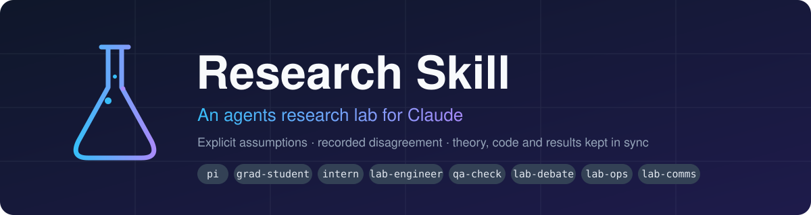
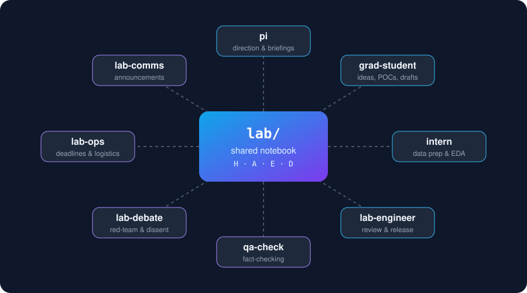
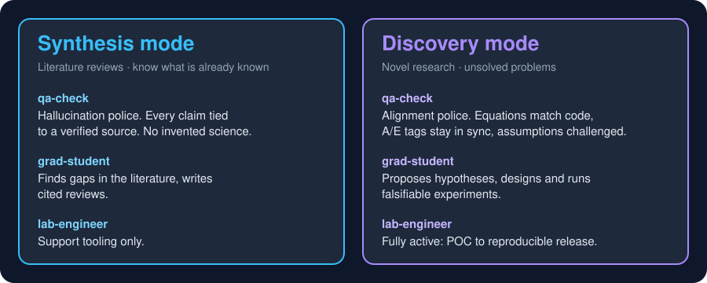
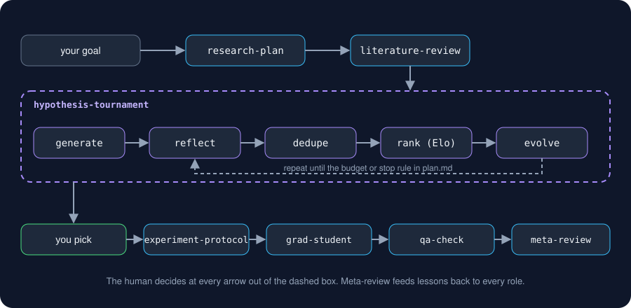
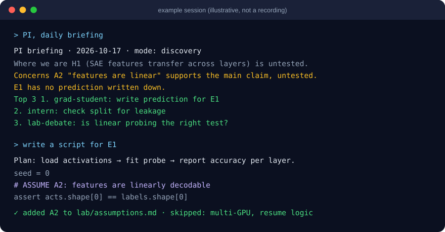

<p align="center">
  
</p>

<p align="center">
  <a href="LICENSE"></a>
  
  
  
  <a href="https://github.com/iamgroot400/research-skill/stargazers"></a>
</p>

<h3 align="center">Turn Claude into a small research lab, not a product engineer.</h3>

<p align="center">
  <a href="#install">Install</a> ·
  <a href="#the-lab">The lab</a> ·
  <a href="#two-research-modes">Modes</a> ·
  <a href="#co-scientist-loop">Co-scientist loop</a> ·
  <a href="#quick-start">Quick start</a> ·
  <a href="#how-it-works">How it works</a> ·
  <a href="#contributing">Contributing</a>
</p>

---

## Why this exists

Most AI coding setups are tuned for **shipping products**: defensive code, exhaustive edge cases, scale. Research is a different job. The setup has to be precise, but the code does not need to be production-grade. What matters is:

| Research needs | Typical AI coding gives you |
|---|---|
| Code you can check against the paper | Long, convoluted implementations |
| Assumptions written down and traceable | Assumptions buried in edge-case handling |
| Agents that can **disagree** | An assistant that agrees with you |
| Theory, code and results that stay aligned | Code that drifts from the idea |
| Fast iteration | Heavy scaffolding up front |

**Research Skill** gives Claude the roles of a real lab. They share one plain-markdown notebook, so context and intent survive between sessions and between roles.

## The lab

<p align="center">
  
</p>

| Skill | Role | Try asking |
|-------|------|------------|
| 🧰 **`lab-setup`** | Opens the lab | *"Set up the lab for my project on X"* |
| 🧭 **`pi`** | Lab head and your right hand | *"Daily briefing"* · *"Are we drifting?"* · *"Funding ideas"* |
| 🎓 **`grad-student`** | Ideas, experiments, POCs, paper drafts | *"Propose directions"* · *"Design an experiment for H2"* · *"Draft the method section"* |
| 🧑‍💻 **`intern`** | Data prep, EDA, scouting, side experiments | *"Clean this dataset"* · *"Quick EDA"* · *"Find datasets on …"* |
| 🛠️ **`lab-engineer`** | Code review, POC → reproducible release | *"Review this for bugs that change results"* · *"Prep the code release"* |
| 🔍 **`qa-check`** | Theory ↔ code ↔ results ↔ references | *"Fact-check the draft before submission"* |
| ⚖️ **`lab-debate`** | Structured disagreement and red-teaming | *"Argue against method X"* · *"What would reviewer 2 say?"* |
| 🗂️ **`lab-ops`** | Deadlines, checklists, travel, paperwork | *"Submission checklist for …"* · *"Draft a visa letter"* |
| 📣 **`lab-comms`** | Announcements, newsletters, talks, venues | *"Announcement thread for the paper"* · *"Where can I present this?"* |
| 📐 **`research-code`** | House coding style, applied by every role that writes code | runs automatically |
| 🗺️ **`research-plan`** | Supervisor: turns a goal into success criteria, pipeline and budget | *"Plan this goal"* |
| 🏆 **`hypothesis-tournament`** | Generate, critique, dedupe, rank (Elo) and evolve hypotheses | *"Find the best hypothesis for …"* |
| 🧐 **`reflect`** | Reviews one idea for novelty, plausibility and testability | *"Has this been done?"* · *"Poke holes in this"* |
| 🧬 **`evolve`** | Repairs, simplifies, combines or reframes a strong idea | *"Make this stronger"* |
| 📋 **`experiment-protocol`** | Controls, power, analysis plan and pre-committed decision rules | *"Write the protocol for H1"* |
| 📚 **`literature-review`** | Claim-to-source table; only cites papers it actually opened | *"What is known about X?"* |
| 🔁 **`meta-review`** | Finds recurring problems across the notebook, feeds back to roles | *"What keeps going wrong?"* |

## Two research modes

You declare the mode **once**, during `lab-setup`. It is saved in `lab/charter.md`, and every role adapts to it.

<p align="center">
  
</p>

Switching modes is a logged decision in `lab/decisions.md`, so a project can start in synthesis (map the field) and move to discovery (attack the gap).

## Co-scientist loop

The newer skills follow the generate, debate and evolve design that Google Research described in its [AI co-scientist](https://research.google/blog/accelerating-scientific-breakthroughs-with-an-ai-co-scientist/) post. A supervisor plans, candidate hypotheses are generated, critiqued, de-duplicated and ranked in pairwise debates, and the best are evolved and re-ranked. The ranking uses Elo ratings, computed by a small script ([`elo.py`](skills/hypothesis-tournament/elo.py)) instead of by the model.

<p align="center">
  
</p>

> **Independent project.** This is an open-source reimplementation of the idea as prompts and files, inspired by that post. It is not Google's system, it is not affiliated with Google, and it does not use Gemini. Elo here measures a model's preference among generated ideas, **not truth**, so only experiments settle a hypothesis.

## See it in action

<p align="center">
  
</p>

> The picture above is an illustrative mock-up of the flow, not a recording of a real run.

## Install

### Claude Code (plugin, recommended)

```text
/plugin marketplace add iamgroot400/research-skill
/plugin install research-lab@research-skill
```

### Claude Code (copy the skills)

Copy the folders in [`skills/`](skills) to `~/.claude/skills/` (all projects) or `<project>/.claude/skills/` (one project).

### Claude.ai and Claude desktop

Zip each folder in `skills/` on its own, with the folder and its `SKILL.md` inside the zip, and upload it under **Settings → Capabilities → Skills**.

## Quick start

1. **Open the lab.** Say *"Set up the lab for my project on …"*. Pick a mode and answer a few questions once.
2. **Get your bearings.** *"PI, daily briefing"* gives status, concerns and the top 3 tasks, each with an owner.
3. **Explore.** *"grad-student: propose directions for H1"* returns ranked ideas, each with the cheapest experiment that could kill it.
4. **Stress-test.** *"Red-team direction 2"* has `lab-debate` argue it out, then logs the decision and its dissent.
5. **Build.** *"grad-student: design and POC E1"* writes the prediction first, then minimal code tagged with assumptions.
6. **Check.** *"lab-engineer: review E1"* looks for bugs that change results.
7. **Ship.** Before submitting: `qa-check` → `lab-ops` checklist → `lab-comms` announcement pack.

## How it works

### The lab notebook

```text
lab/
├── charter.md          research mode, question, hypotheses (H1..), scope. Human-owned.
├── assumptions.md      assumption register (A1..)
├── decisions.md        decision log with recorded dissent (D1..)
├── deadlines.md        dated deadlines and internal milestones
├── experiments/        experiment cards (E1..), prediction written BEFORE running
├── notebook/           daily log, every role appends
└── qa/  comms/  data/  reports from qa-check, lab-comms and intern
results/E*/             experiment outputs, never overwritten
```

### Core ideas

- 🧠 **Shared memory, not shared chat.** Every role reads `lab/` before acting and appends to it after.
- 🏷️ **Assumptions are first-class.** Each gets an ID (`A3`) in `assumptions.md` and a `# ASSUME A3:` tag in the code. `qa-check` verifies the two stay in sync.
- 🔮 **Predictions before results.** An experiment card records what would falsify the hypothesis *before* any code runs. This blocks quietly rewriting the hypothesis after the fact.
- 🗣️ **Dissent is recorded.** Decisions keep their strongest unrefuted counterargument and a "revisit if" trigger.
- 📐 **Research code is not production code.** Linear scripts, paper-shaped names, `assert` over `try/except`, no speculative abstraction. The few cases where defensive code is allowed are spelled out in [`research-code`](skills/research-code/SKILL.md).
- 🙋 **Agents draft, humans decide.** No role submits, posts, pays or edits the charter on its own.

<details>
<summary><b>Example: an assumption tag in code</b></summary>

```python
SEED = 0  # set every seed at the top; outputs go to results/E1/<timestamp>/

# ASSUME A2: features are linearly decodable from layer activations
probe = LogisticRegression(max_iter=1000).fit(train_x, train_y)

assert train_x.shape[0] == train_y.shape[0]   # fail loud, not safe
print(f"layer {layer}: acc={probe.score(test_x, test_y):.3f}")  # Eq. 4
```

</details>

<details>
<summary><b>Example: an experiment card</b></summary>

```markdown
# E1 - Cross-layer probe transfer
- Status: planned
- Tests hypothesis: H1
- Prediction (written BEFORE running): If H1 holds, a probe trained on layer 6
  keeps >80% of its accuracy on layer 8. Below 50% means H1 is in trouble.
- Assumptions relied on: A2
- Results: results/E1/
```

</details>

## Repository layout

```text
research-skill/
├── .claude-plugin/     plugin.json + marketplace.json
├── skills/
│   ├── lab-setup/      scaffold + templates
│   ├── pi/  grad-student/  intern/  lab-engineer/
│   ├── qa-check/  lab-debate/  lab-ops/  lab-comms/
│   ├── research-plan/  hypothesis-tournament/  reflect/  evolve/
│   ├── experiment-protocol/  literature-review/  meta-review/
│   └── research-code/
└── assets/             README images
```

## Contributing

PRs are welcome, especially for:

- new roles, such as a statistician or an ethics reviewer
- field-specific variants: wet lab, social science, theory-only
- venue checklists for `lab-ops`

Keep each `SKILL.md` short. The `description` decides when a skill fires, and the body is read in full every time it runs.

## License

[MIT](LICENSE) © Aashik Khatri

<p align="center"><sub>If this helps your research, a ⭐ helps others find it.</sub></p>
